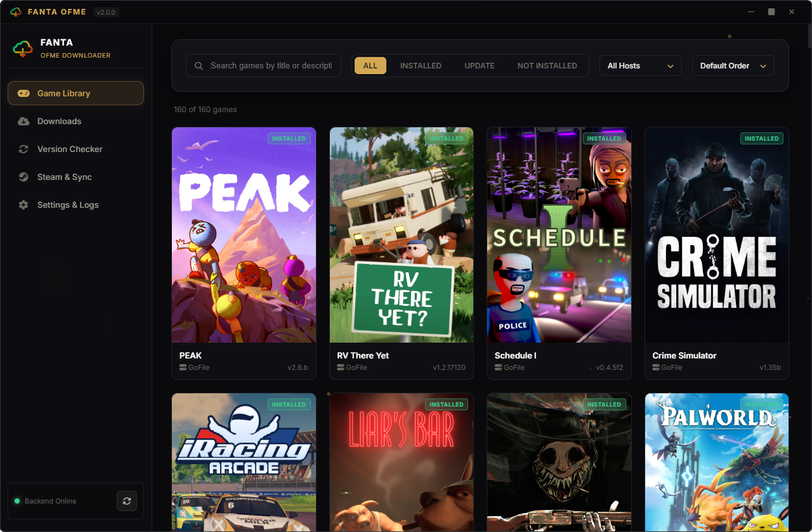
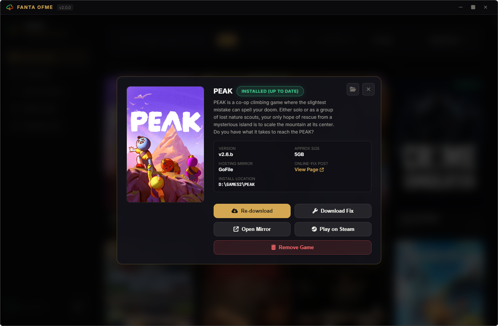
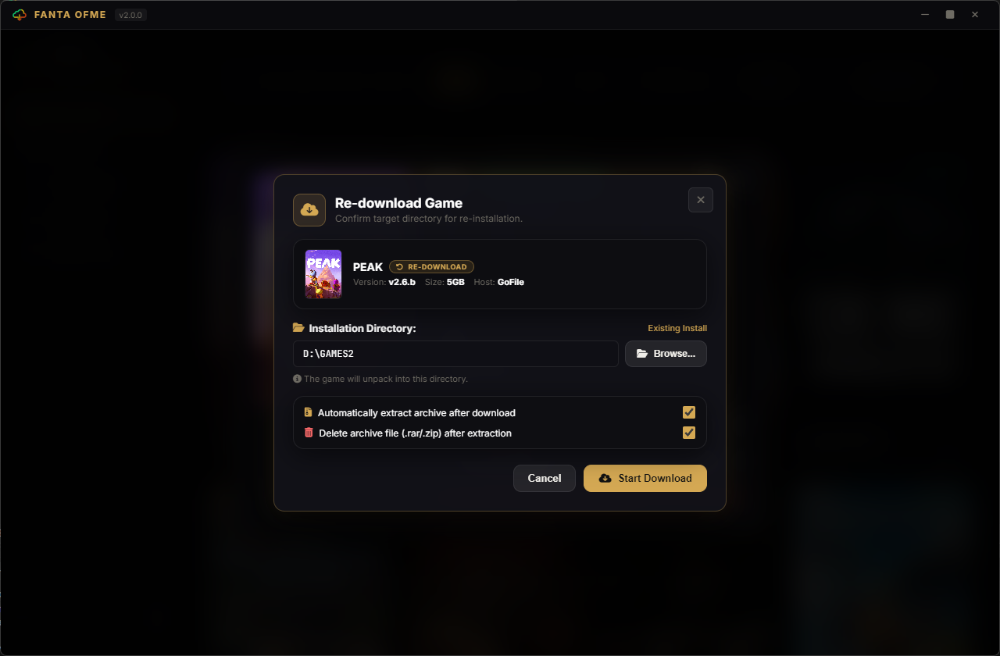
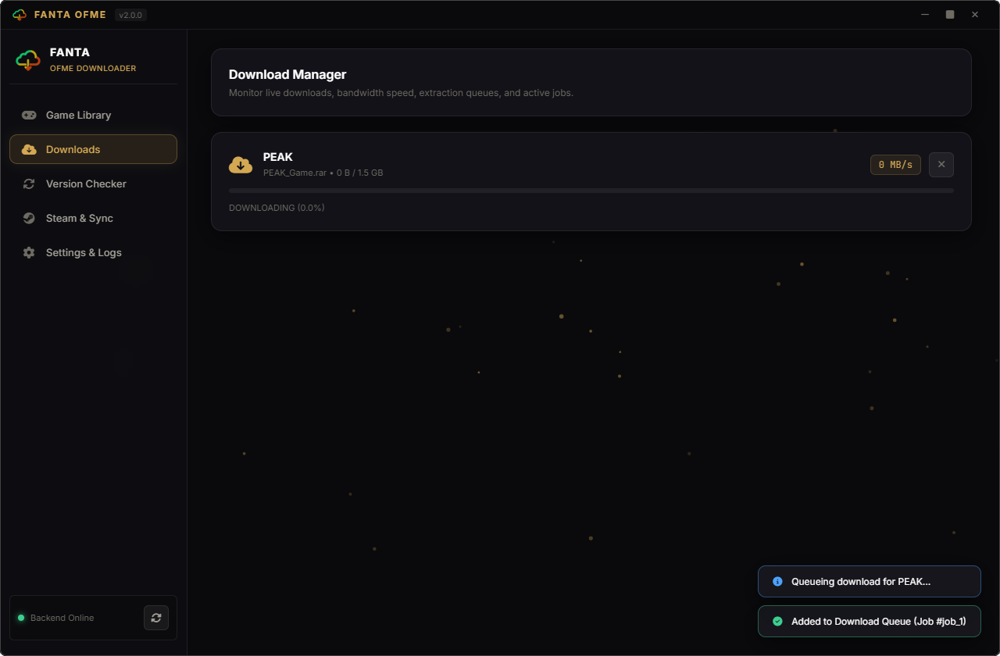
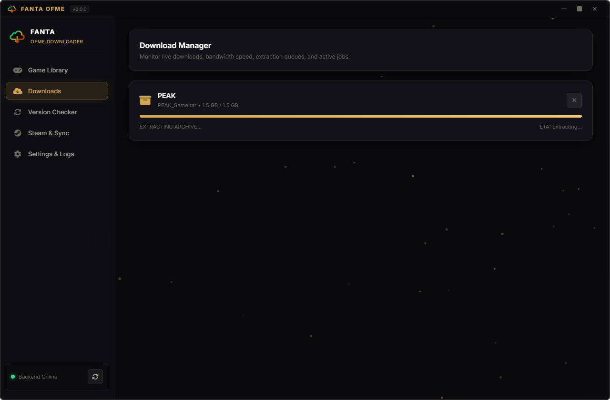
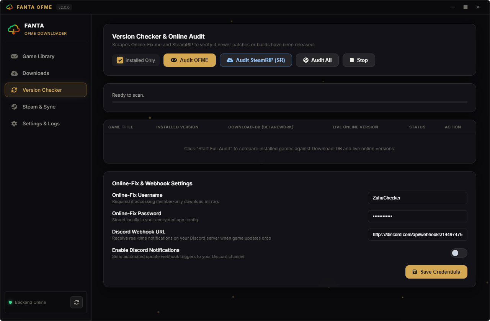
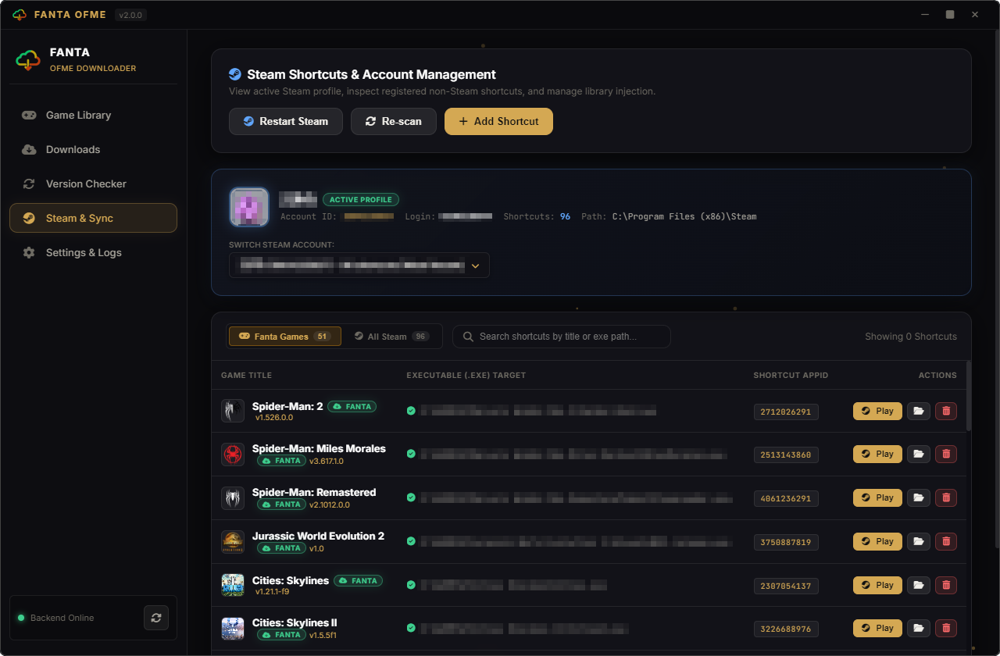
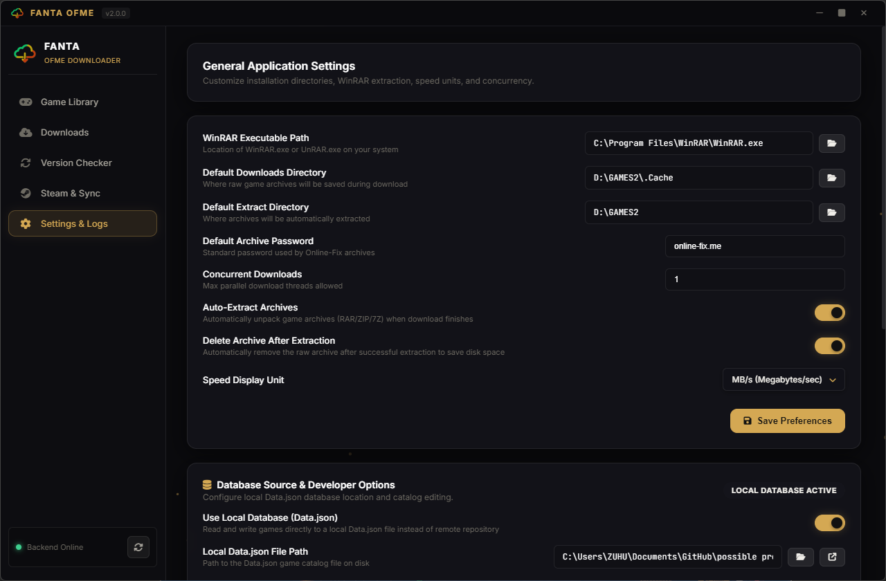

# FANTA OFME Downloader (v2.5.0-beta.5)


-orange.svg)

-FFC131.svg)


> [!NOTE]
> **Active Beta Branch (`BetaRework`)**: This branch runs the **Tauri v2 (Rust)** desktop shell migration with the Python backend sidecar (`2.5.0-beta.x`). For the current production Electron build, switch to the **`main`** branch.

A desktop game library manager and automated downloader for Online-Fix releases. **Fanta OFME Downloader** pairs a dark glassmorphism UI in Tauri v2 (Rust + WebView2) with a modular Python backend sidecar to manage game downloads, automated WinRAR extractions, live version audits, cloud saves, and one-click Steam shortcut integration.

---

## Interface Preview

### Game Library


<details>
<summary><b>Click to view more screenshots (Modal, Downloads, Version Checker, Steam & Settings)</b></summary>

<br>

| Game Details Modal | Download & Installation Setup |
| :---: | :---: |
|  |  |

| Multiplayer Fix Setup | Live Download Queue |
| :---: | :---: |
|  |  |

| Automated Extraction | Online-Fix Version Checker |
| :---: | :---: |
|  |  |

| Steam & Account Sync | Settings & Live Console |
| :---: | :---: |
|  |  |

</details>

---

## Features

- **Interactive Game Library**: Browse and search catalog titles with instant filtering, host tags, and installed/update status pills.
- **Multi-Threaded Download Manager**: Resume-capable downloads with live download speeds, percentage tracking, and host resolution (GoFile, PixelDrain, Mega, etc.).
- **Automated Archive Extraction**: Automatic password-protected extraction (`online-fix.me`) via WinRAR with optional post-extract archive cleanup.
- **Online-Fix.me Version Checker**: Live scraping and audit scanner to check your installed games against latest releases.
- **Steam Shortcut Integration**: Automatically detect local Steam accounts and add games as Non-Steam shortcuts with one click.
- **Safe Uninstaller**: 3-tier uninstall options (Delete Files + Unregister, Unregister Only, or Cancel) with strict root-path deletion protection.
- **Built-in Auto Updater**: Seamless in-place updates via GitHub Releases with notification prompt and 1-click silent background install.

---

## Getting Started

> [!TIP]
> ### Recommended: Download the Executable (.exe)
> This is the easiest way for most users and **does not require a Node.js or Python installation.**
>
> 1. Go to the [**Releases Page**](https://github.com/ZuhuInc/Simple-OFME-Downloader-LIB/releases).
> 2. Choose your preferred build from **Assets**:
>    - **Tauri v2 Beta Installer (`Fanta OFME Downloader_2.5.0-beta.2_x64-setup.exe`)**: Lightweight Rust + WebView2 beta build (`BetaRework` pre-release).
>    - **Stable Setup Installer / Portable (`main` branch)**: Production Electron builds with automated background updating.
> 3. **Important:** Ensure [**WinRAR**](https://www.win-rar.com/) is installed for automated archive unpacking.
> 4. Launch the app and start downloading!
>
> [**Go to the Releases Page to Download**](https://github.com/ZuhuInc/Simple-OFME-Downloader-LIB/releases)
>
> ---
>
> #### 🔄 How Application Updates Work (Beta Channel):
> - **Opt-In Beta Updates**: Go to **Settings ➔ Application Updates** and enable **Receive Beta Updates** to receive prerelease builds (`2.5.0-beta.x`) from GitHub Releases. Leave it off to stay on (or return to) Stable releases from `main`.
> - **Tauri v2 Beta Installer (`Fanta OFME Downloader_<version>_x64-setup.exe`)**: Checks GitHub Releases (respecting your Stable/Beta channel preference) and notifies you whenever a newer build is available.
> - **Legacy Electron Builds (`main` branch)**: Also published on GitHub Releases as Setup Installer and Portable builds with in-place auto-updating.

---

## For Developers & Technical Documentation

<details>
<summary><b>Click here for technical architecture, build instructions, and running from source</b></summary>

<br>

### Architecture Overview (`BetaRework` — Tauri v2 + Python Sidecar)

The application is structured as a hybrid Rust + Python desktop app:
1. **Desktop Shell (Tauri v2 / Rust)**: Manages the native window lifecycle, frameless titlebar/overlay windows, native file dialogs, external links, GitHub Release / Beta channel update checks, and spawns/cleans up the Python backend sidecar.
2. **Frontend UI (`src/renderer/`)**: Glassmorphism HTML5/CSS3/Vanilla JS interface connected through a lightweight compatibility bridge ([tauri-bridge.js](src/renderer/js/tauri-bridge.js)).
3. **Backend Sidecar (`src/backend/`)**: Modular Flask + Flask-SocketIO service managing downloads, multi-host link resolvers (GoFile, PixelDrain, BuzzHeavier, etc.), WinRAR extraction, Steam VDF manipulation, and cloud saves on `127.0.0.1:5004`.

```
├── src-tauri/                # Tauri v2 Rust desktop shell, sidecar & updater
│   ├── src/
│   │   ├── main.rs           # Windows subsystem entry point
│   │   ├── lib.rs            # Tauri commands, dialogs, overlay & window events
│   │   ├── backend.rs        # Python dev runner & production sidecar lifecycle
│   │   └── updater.rs        # SemVer & Beta-aware GitHub/Tauri updater
│   ├── binaries/             # Compiled PyInstaller sidecar (.exe, gitignored)
│   ├── capabilities/         # Tauri v2 window/dialog/opener/updater permissions
│   ├── Cargo.toml
│   └── tauri.conf.json
├── src/
│   ├── renderer/             # Frontend UI (HTML5, Vanilla CSS3 & JS)
│   │   ├── index.html        # Single-page interface
│   │   ├── overlay.html      # Achievement popup overlay window
│   │   ├── app.js            # Frontend router & orchestrator
│   │   ├── styles/           # Glassmorphism design system & animations
│   │   ├── assets/           # Application icons & game posters
│   │   └── js/               # API client, tauri-bridge.js & UI controllers
│   ├── backend/              # Python service layer (dev interpreter / sidecar)
│   │   ├── bridge_server.py  # Flask + Socket.IO server entry point
│   │   ├── config.py         # Settings & dynamic Data.json manager
│   │   ├── database.py       # Catalog cache & local database handler
│   │   ├── downloader.py     # Threaded download engine & speed tracker
│   │   ├── extractor.py      # WinRAR automation wrapper
│   │   ├── runners_manager.py# Multi-runner version & builder orchestration
│   │   ├── steam.py          # Steam VDF shortcuts parser & injector
│   │   ├── version_checker.py# Online-fix.me release scraper
│   │   └── controllers/      # Flask Blueprints (games, downloads, steam, etc.)
│   └── main/                 # Legacy Electron main process (kept merge-compatible)
├── scripts/
│   ├── build.js              # Build orchestrator (Electron & Tauri sidecar)
│   ├── build_backend.py      # PyInstaller freezer (--onedir & --tauri-sidecar)
│   └── set-version.js        # Synchronized SemVer version bumper
├── Assets/
│   └── Menu2/                # Interface preview screenshots
└── package.json              # Node, Tauri CLI & legacy Electron build config
```

---

### Prerequisites

* **Rust & Cargo**: Stable toolchain (via [rustup](https://rustup.rs/)) + WebView2 Runtime (pre-installed on Windows 10/11)
* **Node.js**: v18.0.0 or higher
* **Python**: 3.10 or higher
* **WinRAR**: Installed on system
* **Chrome / Brave / Edge**: Used by Selenium/Curl for GoFile token resolution

---

### Running from Source

#### 1. Clone the repository & switch to `BetaRework`
```bash
git clone https://github.com/ZuhuInc/Simple-OFME-Downloader-LIB.git
cd Simple-OFME-Downloader-LIB
git checkout BetaRework
```

#### 2. Install Node Dependencies
```bash
npm install
```

#### 3. Setup Python Virtual Environment (`.venv`)

**Windows (PowerShell):**
```powershell
python -m venv .venv
.\.venv\Scripts\activate
pip install -r src/backend/requirements.txt
```

**macOS / Linux:**
```bash
python3 -m venv .venv
source .venv/bin/activate
pip install -r src/backend/requirements.txt
```

> **Note:** Tauri (`src-tauri/src/backend.rs`) automatically discovers and spawns `./.venv/Scripts/python.exe src/backend/bridge_server.py` in dev mode and cleans up the process tree when closed.

#### 4. Launch Tauri Development Environment
```bash
npm run tauri dev
```

*(To launch the legacy Electron wrapper instead, run `npm run dev`.)*

---

### Version Management & Bumping

To update the application version across all project files (`package.json`, `package-lock.json`, `src-tauri/tauri.conf.json`, `src-tauri/Cargo.toml`, `src/renderer/index.html`, backend fallbacks, and `README.md`) using SemVer (including prereleases like `2.5.0-beta.2`), run:

```bash
# Set a specific version across Electron, Tauri, Rust & Python
npm run set-version 2.5.0-beta.2

# Or edit "version" in package.json and sync all project files automatically
npm run set-version
```

---

### Building & Packaging Beta Executables (Tauri v2)

First compile the Python backend into a standalone Tauri sidecar (`src-tauri/binaries/bridge_server-x86_64-pc-windows-msvc.exe`), then build the Tauri NSIS Setup installer:

```bash
# 1. Freeze the Python backend as a single-file Tauri sidecar
npm run tauri:sidecar

# 2. Build the Tauri release binary + NSIS Setup installer
npm run tauri build
```

#### Tauri Build Outputs:
- `src-tauri/target/release/fanta-ofme-downloader.exe` & `bridge_server.exe`
- `src-tauri/target/release/bundle/nsis/`: Contains `Fanta OFME Downloader_<version>_x64-setup.exe`

*(Legacy Electron packaging scripts `npm run build:all`, `npm run build:file`, `npm run build:installer`, and `npm run build:backend` remain available for `build/File/` and `build/Installer/`.)*

---

### Running Unit Tests

Backend test suites can be executed via:
```bash
python -m unittest discover -s src/backend/tests
```

</details>

---

## License, Privacy & Terms

This project is licensed under the **MIT Non-Commercial License (MIT-NC)** - see the [LICENSE](LICENSE) file for details. You are free to use, modify, and distribute this software for personal and non-commercial purposes. Commercial use or selling of this software is strictly prohibited.

- **Privacy Policy:** See [PRIVACY.md](PRIVACY.md) or the [Web Privacy Policy](https://zuhuinc.github.io/Simple-OFME-Downloader-LIB/privacy.html)
- **Terms of Service:** See [TERMS.md](TERMS.md) or the [Web Terms of Service](https://zuhuinc.github.io/Simple-OFME-Downloader-LIB/terms.html)

Developed by **ZuhuInc**. All rights reserved. Game titles and assets are property of their respective creators.
